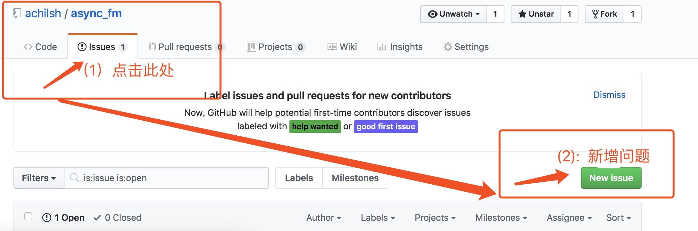

base_frameworks
===============================================
Feature List
------------
- [cnf_center_framewk] - Completed configuration center, routing distribution, automatic/manual offline capability, and hot-reloading of any so in the cluster.
- [debug_access] - Completed TCP access capability testing for Access. Dynamic so loading issues exist when using the internal pb protocol (TODO). Provides the ability to query service names via command codes.
- [thrift_proto_debug] - Tests Thrift serialization for internal business data, used to resolve the core issue in the debug_access branch.
- [alarm_report] - The framework provides sending interfaces for business error alerts and underlying framework error alerts. This interface sends alerts to the agent module. A dedicated alert module will push alerts in the future.
- [alarm_report] - Added an alert email push module.
- [monitor_report_childproc] - Added an independent child process (non-business) to monitor business child process status (coredump report, status report, etc.).
Exposed the framework's timer functionality for business so use; added framework compilation acceleration tools and optimized timer time settings; added manager detection for workers, with alerts triggered when they are dis-active.
Added whitelist filtering during underlying framework routing to facilitate smoother future production deployments (white list configuration remote service is developed, agent is implemented), whitelist functionality improved.
- [monitor_report_childproc] - Added remote child process restart capability (graceful restart after manual offline).
- [client_thrift_vermonitor] - Added support for client access to the system via Thrift.
- [unordered_map_verclient] - Optimized parts of the system's maps using unordered_map.
- [optim_client_thrift_ver] - Optimized the encoding/decoding method for Thrift protocol access; added perf cpu and flame graph generation tools; enriched flame graph retrieval methods.
- [coroutine_ver] - Modified the framework to support coroutine mode for internal services: HTTP, Thrift, and custom protocol access processes are now coroutine-based; asynchronous Redis interfaces have been refactored for coroutines.
(No more writing those start()/callback() hell business codes; business logic can be written completely synchronously, while the underlying layer handles asynchronous send/receive.)

TODO:
------------
- 1. Parent-child process communication efficiency is low, especially when transmitting large blocks of data between them. Optimization point: Combine shared memory and pipes. The pipe transmits the shared memory key for the large data block,
    while shared memory stores the data passed between parent and child processes.
    This ensures the orderliness of new connections (guaranteed by pipes) and optimizes data transfer efficiency between parent and child processes (provided by shared memory).

Q & A
------------
- **`Bug Submission Guide`**

   
